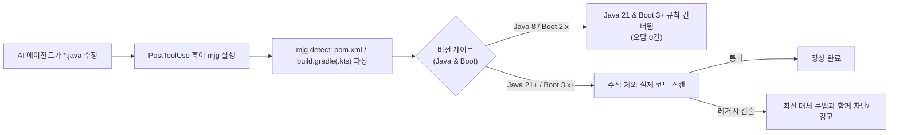

<div align="center">


# modern-java-guidance (`mjg`)

**AI 코딩 에이전트가 Java 8 / Spring Boot 2.x 레거시 코드를 짜지 못하게 막아주는 버전 인식 CLI 스캐너 · Post-Edit Hook · 에이전트 스킬**

[](https://github.com/wkd09/modern-java-guidance/actions/workflows/ci.yml)
[](./LICENSE)
[](./pyproject.toml)
[](./pyproject.toml)

[English](./README.md) | [한국어](./README.ko.md) | [简体中文](./README.zh-CN.md)

[빠른 시작](#빠른-시작) · [기존 도구와의 차이](#왜-checkstyle이나-openrewrite만으로-부족할까요) · [규칙 목록](#버전-게이팅-규칙) · [벤치마크](#벤치마크) · [에이전트 연동](#에이전트-연동)

</div>

---

## 왜 `modern-java-guidance`가 필요한가요?

공개된 Java/Spring 튜토리얼과 오픈소스 코드의 상당수가 **Java 8 & Spring Boot 2.x** 시절에 작성되었기 때문에, AI 코딩 에이전트는 새 **Java 21 + Spring Boot 3.x** 프로젝트에서도 습관적으로 삭제되거나 구식인 API를 생성합니다:

- `jakarta.persistence.*` 대신 `import javax.persistence.*` 사용
- `SecurityFilterChain` Lambda DSL 대신 삭제된 `WebSecurityConfigurerAdapter`, `.antMatchers()`, `.csrf().disable()` 생성
- `RestClient` / `@HttpExchange` 대신 `new RestTemplate()` 사용
- 생성자 주입 대신 `@Autowired` 필드 주입 남발
- I/O 바운드 작업에 Virtual Threads(`newVirtualThreadPerTaskExecutor()`) 대신 `Executors.newFixedThreadPool()` 사용
- `SequencedCollection.getLast()` 대신 `list.get(list.size() - 1)` 사용

대부분의 에이전트 스킬은 읽기 전용 마크다운(`SKILL.md`)뿐이라 모델이 지침을 잊으면 레거시 코드가 그대로 남습니다. **`modern-java-guidance` (`mjg`)**는 **3단계 방어 구조**로 이를 해결합니다:

1. **초경량 `SKILL.md` (4.1 KB)**: 컨텍스트 토큰 부담을 최소화하면서 Java 21–25, Spring Boot 3.x 레퍼런스를 필요할 때만 로드합니다.
2. **자동 버전 감지 (`mjg detect`)**: `pom.xml`, `build.gradle(.kts)`, `gradle/libs.versions.toml`, `.java-version`을 파싱해 Java 8 / Boot 2.x 레거시 프로젝트에는 오탐 경고를 띄우지 않습니다.
3. **토큰 비용 0의 `PostToolUse` 훅 (`mjg hook`)**: 에이전트가 `.java` 파일을 수정한 직후 **약 31 ms** 만에 자동 스캔해 레거시 패턴을 즉시 차단·교정합니다.

---

## Before & After

```diff
- import javax.persistence.Entity;
- import org.springframework.web.client.RestTemplate;
+ import jakarta.persistence.Entity;
+ import org.springframework.web.client.RestClient;

- public class SecurityConfig extends WebSecurityConfigurerAdapter {
-     @Autowired
-     private RestTemplate restTemplate;
-
-     @Override
-     protected void configure(HttpSecurity http) throws Exception {
-         http.csrf().disable()
-             .authorizeRequests()
-             .antMatchers("/public/**").permitAll();
-     }
- }
+ @Configuration
+ public class SecurityConfig {
+     @Bean
+     SecurityFilterChain filterChain(HttpSecurity http) throws Exception {
+         return http
+             .csrf(AbstractHttpConfigurer::disable)
+             .authorizeHttpRequests(auth -> auth
+                 .requestMatchers("/public/**").permitAll()
+                 .anyRequest().authenticated())
+             .build();
+     }
+ }
```

---

## 왜 Checkstyle이나 OpenRewrite만으로 부족할까요?

| 도구 | 역할 | AI 에이전트 환경에서의 한계 |
| :--- | :--- | :--- |
| **Checkstyle / Spotless** | 코드 스타일·포맷팅 검사 | `RestTemplate`, `WebSecurityConfigurerAdapter`, `newFixedThreadPool` 같은 API 세대 교체를 막지 못함 |
| **OpenRewrite** | 대규모 일괄 AST 마이그레이션 | 전체 프로젝트 업그레이드용이라 파일 수정마다 50 ms 이내로 도는 실시간 가드레일로 쓰기 무거움 |
| **마크다운 전용 스킬** | 프롬프트 시점 가이드 | 수동적이라 대화가 길어지면 학습 데이터 관성으로 회귀함 |
| **`mjg` (본 프로젝트)** | **스킬 + 버전 감지기 + Post-Edit 훅** | **생성 전 가이드를 주고, 생성 직후 ~31 ms 만에 레거시 회귀를 결정론적으로 차단** |

---

## 빠른 시작

### 방법 1: 설치 없이 바로 실행 (`uvx`)

```bash
uvx --from git+https://github.com/wkd09/modern-java-guidance.git mjg check .
```

### 방법 2: 원라인 자동 설치 (`curl`)

`uv`, `pipx`, `pip` 중 사용 가능한 도구를 자동 감지해 설치합니다 (Python 3.11+, 외부 의존성 0개):

```bash
curl -fsSL https://raw.githubusercontent.com/wkd09/modern-java-guidance/main/install.sh | bash
```

설치 후 Java/Spring Boot 프로젝트 루트에서 스킬과 `PostToolUse` 훅을 한 번에 연결하세요:

```bash
mjg setup --target all --dir .
```

### 방법 3: 에이전트 스킬만 설치 (`skills` CLI)

```bash
npx skills add wkd09/modern-java-guidance
```

### 기본 CLI 사용법

```bash
# pom.xml / build.gradle(.kts)에서 Java & Spring Boot 버전 자동 감지
mjg detect .
mjg detect . --json

# 감지된 버전 기준으로 Java 소스 스캔
mjg check src/

# 버전을 직접 지정해 엄격 모드(--strict)로 검사
mjg check src/ --java 21 --boot 3.3.0 --strict
```

```text
$ mjg check src/
src/main/java/com/example/LegacyService.java:3: error [BOOT-001] Legacy javax.* EE import detected in a Spring Boot 3.x+ project.
  Legacy : import javax.persistence.Entity;
  Modern : Replace javax.* with jakarta.* (Jakarta EE 10).
src/main/java/com/example/LegacyService.java:18: warning [JAVA-010] Platform thread pool used on Java 21+ for potentially I/O-bound concurrency.
  Legacy : var pool = Executors.newFixedThreadPool(8);
  Modern : Prefer Executors.newVirtualThreadPerTaskExecutor() for I/O-bound workloads (keep bounded pools/semaphores only for CPU-bound or rate-limited tasks).
```

---

## 에이전트 연동

* **Antigravity (`PostToolUse` 훅 + 글로벌 스킬)**: `mjg setup --target antigravity --dir .`
* **Claude Code (`"decision": "block"` 반환 `PostToolUse` 훅)**: `mjg setup --target claude --dir .`
* **Cursor / Copilot / Codex**: `npx skills add wkd09/modern-java-guidance`

---

## 동작 구조



---

## 버전 게이팅 규칙

| 규칙 ID | 심각도 | 적용 기준 | 검출하는 레거시 패턴 | 권장 모던 패턴 |
| :--- | :--- | :--- | :--- | :--- |
| `JAVA-001` | `warning` | Java 16+ | `new Date()`, `SimpleDateFormat` | `java.time` (`Instant`, `LocalDate`, `DateTimeFormatter`) |
| `JAVA-002` | `warning` | Java 16+ | `Collections.unmodifiableList(Arrays.asList(...))` | `List.of(...)`, `Set.of(...)`, `Map.of(...)` |
| `JAVA-003` | `info` | Java 16+ | `String.format(...)` | `"..." .formatted(...)` |
| `JAVA-010` | `warning` | Java 21+ | `Executors.newFixedThreadPool` / `newCachedThreadPool` | `Executors.newVirtualThreadPerTaskExecutor()` (I/O 바운드) |
| `JAVA-011` | `warning` | Java 21+ | `list.get(list.size() - 1)` | `SequencedCollection.getLast()` |
| `BOOT-001` | `error` | Boot 3.0+ | `import javax.{persistence,validation,servlet,...}.*` | `import jakarta.*` |
| `BOOT-002` | `error` | Boot 3.0+ | `extends WebSecurityConfigurerAdapter` | `@Bean SecurityFilterChain` |
| `BOOT-003` | `warning` | Boot 3.2+ | `RestTemplate` / `RestTemplateBuilder` | `RestClient` / `@HttpExchange` |
| `BOOT-004` | `warning` | Boot 3.0+ | `@Autowired` 필드 주입 | 생성자 주입 (`private final`) |
| `BOOT-005` | `error` | Boot 3.0+ | `.antMatchers()` / `.mvcMatchers()` / `.authorizeRequests()` | `.authorizeHttpRequests(a -> a.requestMatchers(...))` |
| `BOOT-006` | `error` | Boot 3.0+ | `.csrf().disable()` | `.csrf(AbstractHttpConfigurer::disable)` |

---

## 벤치마크

`python3 scripts/benchmark.py` 실측 결과 (Apple Silicon, Python 표준 라이브러리만 사용):

| 측정 항목 | 결과 |
| :--- | :--- |
| **10개 Java 파일** (`detect` + `scan_target`) | **1.95 ms** (`0.195 ms/file`) |
| **100개 Java 파일** | **17.55 ms** (`0.175 ms/file`) |
| **500개 Java 파일** | **89.74 ms** (`0.179 ms/file`) |
| **`PostToolUse` 훅 (인프로세스)** | **p50 0.269 ms** / p95 0.368 ms |
| **CLI 서브프로세스 E2E (`mjg hook --format claude`)** | **중앙값 31.0 ms** |
| **검출 정확도 (Java 21 + Boot 3.3)** | **11/11 규칙 전부 검출**, 모던 코드·주석 오탐 0건 |
| **`SKILL.md` 컨텍스트 크기** | **4.1 KB** |

---

## 라이선스

[MIT](./LICENSE)
