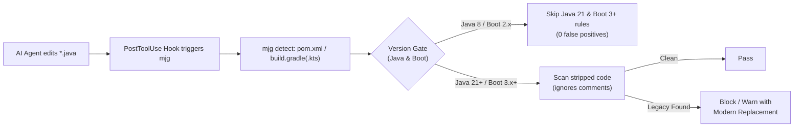

<div align="center">


# modern-java-guidance (`mjg`)

**Modern Java & Spring Boot guidance for AI coding agents — stop Java 8 & Boot 2.x patterns, enforce Java 21+ & Spring Boot 3.x+ best practices.**

[](https://github.com/wkd09/modern-java-guidance/actions/workflows/ci.yml)
[](./LICENSE)
[](./pyproject.toml)
[](./pyproject.toml)

[English](./README.md) | [한국어](./README.ko.md) | [简体中文](./README.zh-CN.md)

[Quickstart](#quickstart) · [Why Not Checkstyle/OpenRewrite?](#why-not-just-checkstyle-or-openrewrite) · [Rules](#version-gated-rules) · [Benchmarks](#benchmarks) · [Agent Integration](#integration-with-coding-agents)

</div>

---

## Why Modern Java Guidance?

LLM training sets are overwhelmingly weighted toward **Java 8 & Spring Boot 2.x** code written between 2016 and 2022. Left unguided, AI coding agents routinely generate removed or deprecated APIs even inside a brand-new **Java 21 + Spring Boot 3.x** project:

- `import javax.persistence.*` instead of `jakarta.persistence.*`
- `extends WebSecurityConfigurerAdapter` + `.antMatchers()` + `.csrf().disable()` instead of `SecurityFilterChain` Lambda DSL
- `new RestTemplate()` instead of `RestClient` or `@HttpExchange`
- `@Autowired` field injection instead of constructor injection
- `Executors.newFixedThreadPool()` for I/O-bound tasks instead of Virtual Threads (`newVirtualThreadPerTaskExecutor()`)
- `list.get(list.size() - 1)` instead of `SequencedCollection.getLast()`

Most agent skills only inject a static markdown prompt—if the model forgets a rule mid-session, legacy code still ships. **`modern-java-guidance` (`mjg`)** solves this with a **multi-layered delivery**:

1. **Lightweight `SKILL.md` (4.1 KB)**: Minimal context footprint with progressive-disclosure references for Java 21–25 and Spring Boot 3.x.
2. **Version-Aware Detection (`mjg detect`)**: Parses `pom.xml`, `build.gradle(.kts)`, `gradle/libs.versions.toml`, and `.java-version` so legacy Java 8 / Boot 2.x repos never receive false-positive warnings.
3. **Zero-Token `PostToolUse` Hook (`mjg hook`)**: Automatically scans every edited `.java` file in **~31 ms** and blocks or warns the agent before legacy patterns settle into your codebase.

---

## Before & After

```diff
- import javax.persistence.Entity;
- import org.springframework.web.client.RestTemplate;
+ import jakarta.persistence.Entity;
+ import org.springframework.web.client.RestClient;

- public class SecurityConfig extends WebSecurityConfigurerAdapter {
-     @Autowired
-     private RestTemplate restTemplate;
-
-     @Override
-     protected void configure(HttpSecurity http) throws Exception {
-         http.csrf().disable()
-             .authorizeRequests()
-             .antMatchers("/public/**").permitAll();
-     }
- }
+ @Configuration
+ public class SecurityConfig {
+     @Bean
+     SecurityFilterChain filterChain(HttpSecurity http) throws Exception {
+         return http
+             .csrf(AbstractHttpConfigurer::disable)
+             .authorizeHttpRequests(auth -> auth
+                 .requestMatchers("/public/**").permitAll()
+                 .anyRequest().authenticated())
+             .build();
+     }
+ }
```

---

## Why Not Just Checkstyle or OpenRewrite?

| Tool | Role | Limitation with AI Agents |
| :--- | :--- | :--- |
| **Checkstyle / Spotless** | Formatting & naming conventions | Does not stop `RestTemplate`, `WebSecurityConfigurerAdapter`, or `newFixedThreadPool` |
| **OpenRewrite** | Heavyweight one-off AST migrations | Built for batch repo upgrades, not sub-50 ms per-edit agent guardrails |
| **Markdown-only Skills** | Prompt-time guidance | Passive—agents still drift back to training-data defaults |
| **`mjg` (This Project)** | **Prompt + Version Detector + Post-Edit Hook** | **Guides generation upfront and deterministically catches regressions in ~31 ms** |

---

## Quickstart

### Option 1: Try Without Installing (`uvx`)

Run directly against any Java/Spring Boot project in one command:

```bash
uvx --from git+https://github.com/wkd09/modern-java-guidance.git mjg check .
```

### Option 2: One-Line Install (`curl`)

Installs `mjg` automatically using `uv`, `pipx`, or `pip` (Python 3.11+, zero external dependencies):

```bash
curl -fsSL https://raw.githubusercontent.com/wkd09/modern-java-guidance/main/install.sh | bash
```

Then enable the Skill + `PostToolUse` hook inside your Java/Spring Boot project:

```bash
mjg setup --target all --dir .
```

### Option 3: Agent Skill Only (`skills` CLI)

```bash
npx skills add wkd09/modern-java-guidance
```

### Everyday CLI Usage

```bash
# Detect Java & Spring Boot versions from pom.xml / build.gradle(.kts)
mjg detect .

# Scan Java sources respecting the detected versions
mjg check src/

# Search & retrieve on-demand Before/After guides (inspired by GoogleChrome/modern-web-guidance)
mjg search "security"
mjg retrieve BOOT-002

# Or override versions explicitly
mjg check src/ --java 21 --boot 3.3.0 --strict
```

```text
$ mjg check src/
src/main/java/com/example/LegacyService.java:3: error [BOOT-001] Legacy javax.* EE import detected in a Spring Boot 3.x+ project.
  Legacy : import javax.persistence.Entity;
  Modern : Replace javax.* with jakarta.* (Jakarta EE 10).
src/main/java/com/example/LegacyService.java:18: warning [JAVA-010] Platform thread pool used on Java 21+ for potentially I/O-bound concurrency.
  Legacy : var pool = Executors.newFixedThreadPool(8);
  Modern : Prefer Executors.newVirtualThreadPerTaskExecutor() for I/O-bound workloads (keep bounded pools/semaphores only for CPU-bound or rate-limited tasks).
```

---

## Integration with Coding Agents

* **Vercel `skills` CLI (Claude Code, Cursor, Copilot, Codex, Antigravity)**:
  ```bash
  npx skills add wkd09/modern-java-guidance
  ```
* **Antigravity (`PostToolUse` hook + global skill)**:
  ```bash
  mjg setup --target antigravity --dir .
  ```
* **Claude Code (`PostToolUse` hook returning `"decision": "block"`)**:
  ```bash
  mjg setup --target claude --dir .
  ```

<details>
<summary>Inspect generated hook configurations (<code>.claude/settings.json</code> / <code>.agents/hooks.json</code>)</summary>

**Claude Code (`.claude/settings.json`)**
```json
{
  "hooks": {
    "PostToolUse": [
      {
        "matcher": "Write|Edit|MultiEdit",
        "hooks": [
          {
            "type": "command",
            "command": "mjg hook --format claude"
          }
        ]
      }
    ]
  }
}
```

**Antigravity (`.agents/hooks.json`)**
```json
{
  "modern-java-guidance": {
    "PostToolUse": [
      {
        "matcher": "write_to_file|replace_file_content|multi_replace_file_content",
        "hooks": [
          {
            "type": "command",
            "command": "mjg hook --format antigravity",
            "timeout": 10
          }
        ]
      }
    ]
  }
}
```

</details>

---

## Architecture



---

## Version-Gated Rules

Rules activate **only** when the detected project meets the minimum Java and Spring Boot versions:

| Rule ID | Severity | Version Gate | Legacy Pattern | Modern Replacement |
| :--- | :--- | :--- | :--- | :--- |
| `JAVA-001` | `warning` | Java 16+ | `new Date()`, `SimpleDateFormat` | `java.time` (`Instant`, `LocalDate`, `DateTimeFormatter`) |
| `JAVA-002` | `warning` | Java 16+ | `Collections.unmodifiableList(Arrays.asList(...))` | `List.of(...)`, `Set.of(...)`, `Map.of(...)` |
| `JAVA-003` | `info` | Java 16+ | `String.format(...)` | `"..." .formatted(...)` |
| `JAVA-010` | `warning` | Java 21+ | `Executors.newFixedThreadPool` / `newCachedThreadPool` | `Executors.newVirtualThreadPerTaskExecutor()` (I/O-bound) |
| `JAVA-011` | `warning` | Java 21+ | `list.get(list.size() - 1)` | `SequencedCollection.getLast()` |
| `BOOT-001` | `error` | Boot 3.0+ | `import javax.{persistence,validation,servlet,...}.*` | `import jakarta.*` |
| `BOOT-002` | `error` | Boot 3.0+ | `extends WebSecurityConfigurerAdapter` | `@Bean SecurityFilterChain` |
| `BOOT-003` | `warning` | Boot 3.2+ | `RestTemplate` / `RestTemplateBuilder` | `RestClient` / `@HttpExchange` |
| `BOOT-004` | `warning` | Boot 3.0+ | `@Autowired` field injection | Constructor injection |
| `BOOT-005` | `error` | Boot 3.0+ | `.antMatchers()` / `.mvcMatchers()` / `.authorizeRequests()` | `.authorizeHttpRequests(a -> a.requestMatchers(...))` |
| `BOOT-006` | `error` | Boot 3.0+ | `.csrf().disable()` | `.csrf(AbstractHttpConfigurer::disable)` |

---

## Benchmarks

### 1. Comparison with Existing Java & Spring Boot Skills

| Feature / Metric | **`modern-java-guidance` (`mjg`)** | **`github/awesome-copilot`**<br>(`java-springboot` + `spring-security`) | **`Amplicode/spring-skills`**<br>(`spring-security-configuration`) | **`Santoshrt999/Java-Claude-Skills`**<br>(`java-modernization-review`) |
| :--- | :--- | :--- | :--- | :--- |
| **Initial `SKILL.md` Size** | **4,157 bytes** (lightest) | 9,737 bytes (4,433 + 5,304) | 17,344 bytes (4.2×) | 20,103 bytes (4.8×) |
| **Executable CLI Scanner** | ✅ `mjg check` (0 LLM tokens) | ❌ Markdown only | ❌ None | ❌ Markdown only |
| **Auto Version Detection** | ✅ `mjg detect` (`pom.xml` / Gradle) | ⚠️ Manual agent read | ⚠️ Requires IntelliJ MCP | ❌ None |
| **`PostToolUse` Auto-Block Hook** | ✅ Antigravity & Claude Code | ❌ None | ❌ None | ❌ None |
| **External / IDE Dependencies** | **Zero** (Python stdlib only) | None | ❌ IntelliJ Amplicode plugin & MCP | None |
| **Java 21+ & Spring Boot 3+ Rules** | ✅ Both covered | ✅ Boot 3/4 & Security 6/7 | ✅ Spring ecosystem | ⚠️ Java 8→21 only (no Boot rules) |

> **Real-world sanity check**: Running `mjg` against `Santoshrt999/Java-Claude-Skills/examples` automatically detects Java 21 from `pom.xml` and flags `TradeProcessor.java:15` (`Executors.newFixedThreadPool(10)` → `[JAVA-010]`) in milliseconds.

### 2. `mjg` Throughput, Latency & Accuracy

Measured with `python3 scripts/benchmark.py` (Apple Silicon, Python standard library only):

| Benchmark | Workload / Condition | Result |
| :--- | :--- | :--- |
| **Small repo scan** (`detect` + `scan_target`) | 10 Java files (65 findings) | **3.10 ms** (`0.310 ms/file`) |
| **Medium repo scan** | 100 Java files (650 findings) | **22.84 ms** (`0.228 ms/file`) |
| **Large repo scan** | 500 Java files (3,250 findings) | **105.24 ms** (`0.210 ms/file`) |
| **Monorepo-scale scan** | 1,000 Java files (6,500 findings) | **183.40 ms** (`0.183 ms/file`) |
| **Build file detection** | `pom.xml` / `build.gradle.kts` / `.java-version` | **0.059 ms** / **0.043 ms** / **0.045 ms** |
| **`PostToolUse` hook (in-process)** | Single `.java` file (50 runs) | **p50 0.257 ms** · p95 0.317 ms · max 0.373 ms |
| **CLI subprocess E2E (`mjg hook`)** | Full process spawn (10 runs) | **31.0 ms median** (30.5–86.3 ms) |
| **Detection accuracy** | Java 21 + Boot 3.3.4 | **11/11 rules detected**, 0 false positives on modern code or comments |

---

## Inspired By

- [`GoogleChrome/modern-web-guidance`](https://github.com/GoogleChrome/modern-web-guidance) — Browser platform modern guidance
- [`JetBrains/go-modern-guidelines`](https://github.com/JetBrains/go-modern-guidelines) — Version-aware Go modern guidelines
- [`yottayoshida/modern-python-guidance`](https://github.com/yottayoshida/modern-python-guidance) — Multi-layered Python guidance with PostToolUse hooks

## License

[MIT](./LICENSE)
