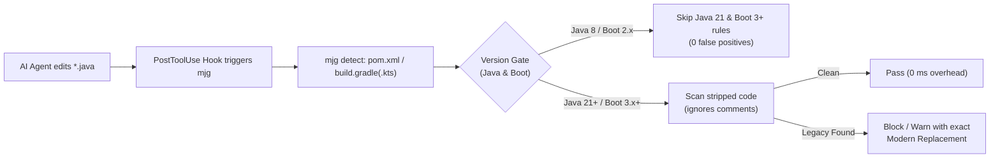

<div align="center">

# modern-java-guidance (`mjg`)

**Stop AI coding agents from writing Java 8 & Spring Boot 2.x legacy code.**

A version-aware **CLI scanner**, **Post-Edit Hook**, and **Agent Skill (`SKILL.md`)** that detects your project's Java & Spring Boot versions and automatically catches outdated patterns right after your AI edits a file.

[](https://github.com/wkd09/modern-java-guidance/actions/workflows/ci.yml)
[](./LICENSE)
[](./pyproject.toml)
[](./pyproject.toml)
[](#quick-start)

</div>

---

## Why `modern-java-guidance`?

Because most public Java tutorials and repositories were written in the **Java 8 & Spring Boot 2.x** era, coding agents routinely emit deprecated or removed APIs even inside a brand-new **Java 21 + Spring Boot 3.x** project.

Most existing agent skills are **markdown-only prompts**—if the LLM ignores a paragraph, legacy code still lands in your repo. `modern-java-guidance` pairs a lightweight `SKILL.md` (**4.1 KB**) with an executable, zero-dependency **CLI & `PostToolUse` hook** that verifies every `.java` edit in ~31 ms.

### Before vs. After

<table>
<tr>
<th width="50%">❌ Typical Un-guided LLM Output</th>
<th width="50%">✅ Enforced by <code>mjg</code> (Java 21 + Boot 3.3)</th>
</tr>
<tr>
<td>

```java
import javax.persistence.Entity;
import org.springframework.web.client.RestTemplate;

public class SecurityConfig
    extends WebSecurityConfigurerAdapter {

  @Autowired
  private RestTemplate restTemplate;

  @Override
  protected void configure(HttpSecurity http)
      throws Exception {
    http.csrf().disable()
        .authorizeRequests()
        .antMatchers("/public/**").permitAll();
  }
}
```

</td>
<td>

```java
import jakarta.persistence.Entity;
import org.springframework.web.client.RestClient;

@Configuration
public class SecurityConfig {

  @Bean
  SecurityFilterChain filterChain(HttpSecurity http)
      throws Exception {
    return http
        .csrf(AbstractHttpConfigurer::disable)
        .authorizeHttpRequests(auth -> auth
            .requestMatchers("/public/**").permitAll()
            .anyRequest().authenticated())
        .build();
  }
}
```

</td>
</tr>
</table>

---

## How It Works



### Example `mjg check` Output

```text
$ mjg check src/
src/main/java/com/example/LegacyService.java:3: error [BOOT-001] Legacy javax.* EE import detected in a Spring Boot 3.x+ project.
  Legacy : import javax.persistence.Entity;
  Modern : Replace javax.* with jakarta.* (Jakarta EE 10).
src/main/java/com/example/LegacyService.java:18: warning [JAVA-010] Platform thread pool used on Java 21+ for potentially I/O-bound concurrency.
  Legacy : var pool = Executors.newFixedThreadPool(8);
  Modern : Prefer Executors.newVirtualThreadPerTaskExecutor() for I/O-bound workloads (keep bounded pools/semaphores only for CPU-bound or rate-limited tasks).
```

---

## Quick Start

### 1. Install the Agent Skill (`SKILL.md`)

```bash
npx skills add wkd09/modern-java-guidance
```

### 2. Install the `mjg` CLI & Hook Runner

Requires Python 3.11+ with **zero third-party runtime dependencies**:

```bash
# With uv (recommended)
uv tool install git+https://github.com/wkd09/modern-java-guidance.git

# Or with pip
pip install git+https://github.com/wkd09/modern-java-guidance.git
```

### 3. Enable Post-Edit Hooks in Your Java Project

```bash
# Antigravity (.agents/hooks.json + global skill)
mjg setup --target antigravity --dir /path/to/your/spring-boot-project

# Claude Code (.claude/settings.json)
mjg setup --target claude --dir /path/to/your/spring-boot-project

# Both
mjg setup --target all --dir /path/to/your/spring-boot-project
```

<details>
<summary>Manual Hook Configuration (Claude Code / Antigravity)</summary>

**Claude Code (`.claude/settings.json`)**
```json
{
  "hooks": {
    "PostToolUse": [
      {
        "matcher": "Write|Edit|MultiEdit",
        "hooks": [
          {
            "type": "command",
            "command": "mjg hook --format claude"
          }
        ]
      }
    ]
  }
}
```

**Antigravity (`.agents/hooks.json`)**
```json
{
  "modern-java-guidance": {
    "PostToolUse": [
      {
        "matcher": "write_to_file|replace_file_content|multi_replace_file_content",
        "hooks": [
          {
            "type": "command",
            "command": "mjg hook --format antigravity",
            "timeout": 10
          }
        ]
      }
    ]
  }
}
```

</details>

---

## CLI Reference

```bash
# Detect Java & Spring Boot version from pom.xml, build.gradle(.kts), libs.versions.toml, or .java-version
mjg detect .
mjg detect . --json

# Scan a file or directory using auto-detected versions
mjg check src/

# Override versions explicitly & fail on warnings too
mjg check src/ --java 21 --boot 3.3.0 --strict
```

---

## Rules Enforced

Every rule is **version-gated** so legacy projects (`Java <= 11`, `Spring Boot 2.x`) are never flooded with invalid warnings.

| Rule ID | Severity | Version Gate | Legacy Pattern | Modern Replacement |
| :--- | :--- | :--- | :--- | :--- |
| `JAVA-001` | `warning` | Java 16+ | `new Date()`, `SimpleDateFormat` | `java.time` (`Instant`, `LocalDate`, `DateTimeFormatter`) |
| `JAVA-002` | `warning` | Java 16+ | `Collections.unmodifiableList(Arrays.asList(...))` | `List.of(...)`, `Set.of(...)`, `Map.of(...)` |
| `JAVA-003` | `info` | Java 16+ | `String.format(...)` | `"..." .formatted(...)` |
| `JAVA-010` | `warning` | Java 21+ | `Executors.newFixedThreadPool` / `newCachedThreadPool` | `Executors.newVirtualThreadPerTaskExecutor()` (I/O-bound) |
| `JAVA-011` | `warning` | Java 21+ | `list.get(list.size() - 1)` | `SequencedCollection.getLast()` |
| `BOOT-001` | `error` | Boot 3.0+ | `import javax.{persistence,validation,servlet,...}.*` | `import jakarta.*` |
| `BOOT-002` | `error` | Boot 3.0+ | `extends WebSecurityConfigurerAdapter` | `@Bean SecurityFilterChain` |
| `BOOT-003` | `warning` | Boot 3.2+ | `RestTemplate` / `RestTemplateBuilder` | `RestClient` / `@HttpExchange` |
| `BOOT-004` | `warning` | Boot 3.0+ | `@Autowired` field injection | Constructor injection |
| `BOOT-005` | `error` | Boot 3.0+ | `.antMatchers()` / `.mvcMatchers()` / `.authorizeRequests()` | `.authorizeHttpRequests(a -> a.requestMatchers(...))` |
| `BOOT-006` | `error` | Boot 3.0+ | `.csrf().disable()` | `.csrf(AbstractHttpConfigurer::disable)` |

---

## Benchmarks

Measured with `python3 scripts/benchmark.py` (Apple Silicon, Python standard library only):

| Metric | Result |
| :--- | :--- |
| **10 Java files** (`detect` + `scan_target`) | **1.95 ms** (`0.195 ms/file`) |
| **100 Java files** | **17.55 ms** (`0.175 ms/file`) |
| **500 Java files** | **89.74 ms** (`0.179 ms/file`) |
| **PostToolUse Hook (in-process)** | **p50 0.269 ms** / p95 0.368 ms |
| **CLI Subprocess E2E (`mjg hook --format claude`)** | **31.0 ms median** |
| **Detection Accuracy (Java 21 + Boot 3.3)** | **11/11 rules detected**, 0 false positives on modern code or comments |
| **`SKILL.md` context footprint** | **4.1 KB** (lightweight progressive disclosure) |

---

## Repository Structure

```text
modern-java-guidance/
├── .github/workflows/ci.yml              # CI (unit tests + benchmark on Python 3.11–3.13)
├── pyproject.toml                        # Zero-dependency package & `mjg` entry point
├── scripts/
│   └── benchmark.py                      # Reproducible throughput, latency & accuracy benchmark
├── skills/modern-java-guidance/
│   ├── SKILL.md                          # Lightweight agent skill router & checklist
│   └── references/
│       ├── java-21-25-core.md            # record, sealed, switch patterns, SequencedCollection, Virtual Threads
│       └── spring-boot-3x.md             # SecurityFilterChain, RestClient, jakarta.*, @ConfigurationProperties
├── src/modern_java_guidance/
│   ├── detector.py                       # pom.xml / build.gradle(.kts) / libs.versions.toml parser
│   ├── scanner.py                        # Comment-aware, version-gated Java/Boot scanner
│   ├── hook.py                           # Antigravity & Claude Code PostToolUse handler
│   └── cli.py                            # `mjg` CLI (detect, check, hook, setup)
└── tests/
    └── test_mjg.py                       # Unit & integration tests
```

---

## Inspired By

- [`GoogleChrome/modern-web-guidance`](https://github.com/GoogleChrome/modern-web-guidance)
- [`JetBrains/go-modern-guidelines`](https://github.com/JetBrains/go-modern-guidelines)
- [`yottayoshida/modern-python-guidance`](https://github.com/yottayoshida/modern-python-guidance)

## License

[MIT](./LICENSE)
