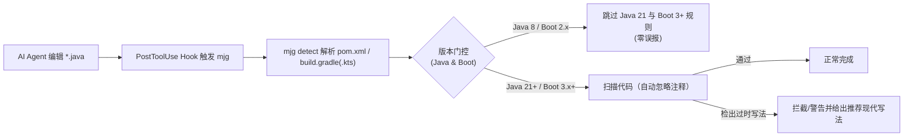

<div align="center">


# modern-java-guidance (`mjg`)

**阻止 AI 编程助手生成 Java 8 与 Spring Boot 2.x 过时代码的版本感知 CLI 扫描器 · Post-Edit Hook · Agent Skill**

[](https://github.com/wkd09/modern-java-guidance/actions/workflows/ci.yml)
[](./LICENSE)
[](./pyproject.toml)
[](./pyproject.toml)

[English](./README.md) | [한국어](./README.ko.md) | [简体中文](./README.zh-CN.md)

[快速开始](#快速开始) · [与传统工具对比](#为什么不能只用-checkstyle-或-openrewrite) · [规则列表](#版本门控规则) · [性能基准](#性能基准测试) · [Agent 集成](#与编程-agent-集成)

</div>

---

## 为什么需要 `modern-java-guidance`？

由于大多数公开的 Java/Spring 教程和开源代码写于 **Java 8 与 Spring Boot 2.x** 时期，AI 编程助手即使在全新的 **Java 21 + Spring Boot 3.x** 项目中，也经常习惯性地生成已被移除或过时的 API：

- 使用 `import javax.persistence.*` 而不是 `jakarta.persistence.*`
- 使用已被移除的 `WebSecurityConfigurerAdapter`、`.antMatchers()` 和 `.csrf().disable()`，而不是 `SecurityFilterChain` Lambda DSL
- 使用 `new RestTemplate()` 而不是 `RestClient` 或 `@HttpExchange`
- 使用 `@Autowired` 字段注入而不是构造函数注入
- 在 I/O 密集型任务中使用 `Executors.newFixedThreadPool()` 而不是虚拟线程（`newVirtualThreadPerTaskExecutor()`）
- 使用 `list.get(list.size() - 1)` 而不是 `SequencedCollection.getLast()`

大多数现有的 Agent Skill 只是静态 Markdown 提示词，模型一旦遗忘规则，过时代码依然会进入仓库。**`modern-java-guidance` (`mjg`)** 通过**三层防护机制**解决这一问题：

1. **轻量级 `SKILL.md`（4.1 KB）**：极低上下文开销，按需加载 Java 21–25 与 Spring Boot 3.x 参考文档。
2. **版本自动检测（`mjg detect`）**：解析 `pom.xml`、`build.gradle(.kts)`、`gradle/libs.versions.toml` 和 `.java-version`，避免对 Java 8 / Boot 2.x 老项目产生误报。
3. **零 Token 消耗的 `PostToolUse` Hook（`mjg hook`）**：每次 AI 修改 `.java` 文件后仅需 **~31 ms** 自动扫描并拦截/提示替换方案。

---

## 前后对比

```diff
- import javax.persistence.Entity;
- import org.springframework.web.client.RestTemplate;
+ import jakarta.persistence.Entity;
+ import org.springframework.web.client.RestClient;

- public class SecurityConfig extends WebSecurityConfigurerAdapter {
-     @Autowired
-     private RestTemplate restTemplate;
-
-     @Override
-     protected void configure(HttpSecurity http) throws Exception {
-         http.csrf().disable()
-             .authorizeRequests()
-             .antMatchers("/public/**").permitAll();
-     }
- }
+ @Configuration
+ public class SecurityConfig {
+     @Bean
+     SecurityFilterChain filterChain(HttpSecurity http) throws Exception {
+         return http
+             .csrf(AbstractHttpConfigurer::disable)
+             .authorizeHttpRequests(auth -> auth
+                 .requestMatchers("/public/**").permitAll()
+                 .anyRequest().authenticated())
+             .build();
+     }
+ }
```

---

## 为什么不能只用 Checkstyle 或 OpenRewrite？

| 工具 | 定位 | 在 AI Agent 工作流中的局限 |
| :--- | :--- | :--- |
| **Checkstyle / Spotless** | 代码格式与命名规范检查 | 无法阻止 `RestTemplate`、`WebSecurityConfigurerAdapter`、`newFixedThreadPool` 等 API 代际退化 |
| **OpenRewrite** | 大规模一次性 AST 迁移 | 适合全库批量升级，不适合每次编辑 <50 ms 的实时 Agent 护栏 |
| **纯 Markdown Skill** | 提示词阶段引导 | 被动约束，长对话中模型仍容易退回训练数据习惯 |
| **`mjg`（本项目）** | **Skill + 版本检测 + Post-Edit Hook** | **生成前引导，生成后 ~31 ms 内确定性拦截过时代码** |

---

## 快速开始

### 方式一：免安装直接运行（`uvx`）

```bash
uvx --from git+https://github.com/wkd09/modern-java-guidance.git mjg check .
```

### 方式二：一键安装（`curl`）

自动检测 `uv`、`pipx` 或 `pip` 完成安装（需要 Python 3.11+，**零第三方依赖**）：

```bash
curl -fsSL https://raw.githubusercontent.com/wkd09/modern-java-guidance/main/install.sh | bash
```

安装后在你的 Java / Spring Boot 项目根目录一键配置 Skill 与 `PostToolUse` Hook：

```bash
mjg setup --target all --dir .
```

### 方式三：仅安装 Agent Skill（`skills` CLI）

```bash
npx skills add wkd09/modern-java-guidance
```

### 常用 CLI 命令

```bash
# 从 pom.xml / build.gradle(.kts) 自动检测 Java 与 Spring Boot 版本
mjg detect .
mjg detect . --json

# 按检测到的版本扫描 Java 源码
mjg check src/

# 手动指定版本并开启严格模式
mjg check src/ --java 21 --boot 3.3.0 --strict
```

---

## 与编程 Agent 集成

* **Antigravity（`PostToolUse` Hook + 全局 Skill）**：`mjg setup --target antigravity --dir .`
* **Claude Code（返回 `"decision": "block"` 的 `PostToolUse` Hook）**：`mjg setup --target claude --dir .`
* **Cursor / Copilot / Codex**：`npx skills add wkd09/modern-java-guidance`

---

## 工作流程



---

## 版本门控规则

| 规则 ID | 级别 | 生效版本 | 检测的过时写法 | 推荐现代写法 |
| :--- | :--- | :--- | :--- | :--- |
| `JAVA-001` | `warning` | Java 16+ | `new Date()`, `SimpleDateFormat` | `java.time` (`Instant`, `LocalDate`, `DateTimeFormatter`) |
| `JAVA-002` | `warning` | Java 16+ | `Collections.unmodifiableList(Arrays.asList(...))` | `List.of(...)`, `Set.of(...)`, `Map.of(...)` |
| `JAVA-003` | `info` | Java 16+ | `String.format(...)` | `"..." .formatted(...)` |
| `JAVA-010` | `warning` | Java 21+ | `Executors.newFixedThreadPool` / `newCachedThreadPool` | `Executors.newVirtualThreadPerTaskExecutor()`（I/O 密集型） |
| `JAVA-011` | `warning` | Java 21+ | `list.get(list.size() - 1)` | `SequencedCollection.getLast()` |
| `BOOT-001` | `error` | Boot 3.0+ | `import javax.{persistence,validation,servlet,...}.*` | `import jakarta.*` |
| `BOOT-002` | `error` | Boot 3.0+ | `extends WebSecurityConfigurerAdapter` | `@Bean SecurityFilterChain` |
| `BOOT-003` | `warning` | Boot 3.2+ | `RestTemplate` / `RestTemplateBuilder` | `RestClient` / `@HttpExchange` |
| `BOOT-004` | `warning` | Boot 3.0+ | `@Autowired` 字段注入 | 构造函数注入（`private final`） |
| `BOOT-005` | `error` | Boot 3.0+ | `.antMatchers()` / `.mvcMatchers()` / `.authorizeRequests()` | `.authorizeHttpRequests(a -> a.requestMatchers(...))` |
| `BOOT-006` | `error` | Boot 3.0+ | `.csrf().disable()` | `.csrf(AbstractHttpConfigurer::disable)` |

---

## 性能基准测试

使用 `python3 scripts/benchmark.py` 实测（Apple Silicon，仅使用 Python 标准库）：

| 测试项 | 实测结果 |
| :--- | :--- |
| **10 个 Java 文件**（`detect` + `scan_target`） | **1.95 ms**（`0.195 ms/file`） |
| **100 个 Java 文件** | **17.55 ms**（`0.175 ms/file`） |
| **500 个 Java 文件** | **89.74 ms**（`0.179 ms/file`） |
| **`PostToolUse` Hook（进程内）** | **p50 0.269 ms** / p95 0.368 ms |
| **CLI 子进程端到端延迟（`mjg hook --format claude`）** | **中位数 31.0 ms** |
| **检测准确率（Java 21 + Boot 3.3）** | **11/11 规则全部检出**，现代代码与注释零误报 |
| **`SKILL.md` 上下文体积** | **4.1 KB** |

---

## 开源协议

[MIT](./LICENSE)
